# itsrealkaran

Compact is the best rank. Regular is the top three. Wide is the six-rank row. The grade is drawn in the trophy.

## classic

**trophies** · classic · mini

`https://github.com/itsrealkaran/nothing-github-trophies?username=itsrealkaran&theme=classic&size=mini`

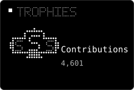

**trophies** · classic · compact

`https://github.com/itsrealkaran/nothing-github-trophies?username=itsrealkaran&theme=classic&size=compact`

**trophies** · classic · regular

`https://github.com/itsrealkaran/nothing-github-trophies?username=itsrealkaran&theme=classic&size=regular`

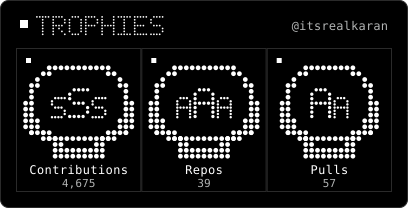

**trophies** · classic · wide

`https://github.com/itsrealkaran/nothing-github-trophies?username=itsrealkaran&theme=classic&size=wide`

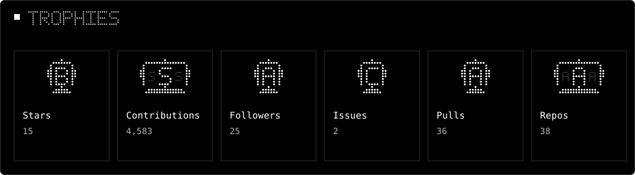

## classic-r

**trophies** · classic-r · mini

`https://github.com/itsrealkaran/nothing-github-trophies?username=itsrealkaran&theme=classic-r&size=mini`

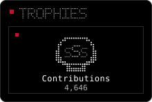

**trophies** · classic-r · compact

`https://github.com/itsrealkaran/nothing-github-trophies?username=itsrealkaran&theme=classic-r&size=compact`

**trophies** · classic-r · regular

`https://github.com/itsrealkaran/nothing-github-trophies?username=itsrealkaran&theme=classic-r&size=regular`

**trophies** · classic-r · wide

`https://github.com/itsrealkaran/nothing-github-trophies?username=itsrealkaran&theme=classic-r&size=wide`

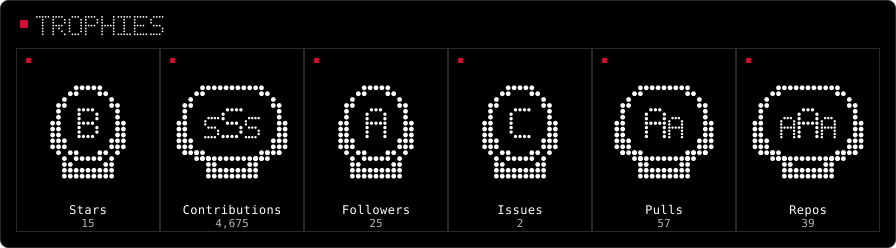

## white

**trophies** · white · mini

`https://github.com/itsrealkaran/nothing-github-trophies?username=itsrealkaran&theme=white&size=mini`

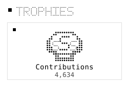

**trophies** · white · compact

`https://github.com/itsrealkaran/nothing-github-trophies?username=itsrealkaran&theme=white&size=compact`

**trophies** · white · regular

`https://github.com/itsrealkaran/nothing-github-trophies?username=itsrealkaran&theme=white&size=regular`

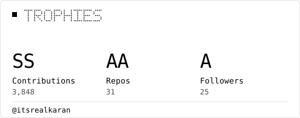

**trophies** · white · wide

`https://github.com/itsrealkaran/nothing-github-trophies?username=itsrealkaran&theme=white&size=wide`

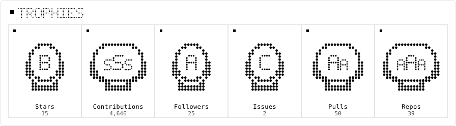

## white-r

**trophies** · white-r · mini

`https://github.com/itsrealkaran/nothing-github-trophies?username=itsrealkaran&theme=white-r&size=mini`

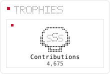

**trophies** · white-r · compact

`https://github.com/itsrealkaran/nothing-github-trophies?username=itsrealkaran&theme=white-r&size=compact`

**trophies** · white-r · regular

`https://github.com/itsrealkaran/nothing-github-trophies?username=itsrealkaran&theme=white-r&size=regular`

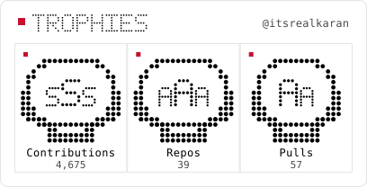

**trophies** · white-r · wide

`https://github.com/itsrealkaran/nothing-github-trophies?username=itsrealkaran&theme=white-r&size=wide`

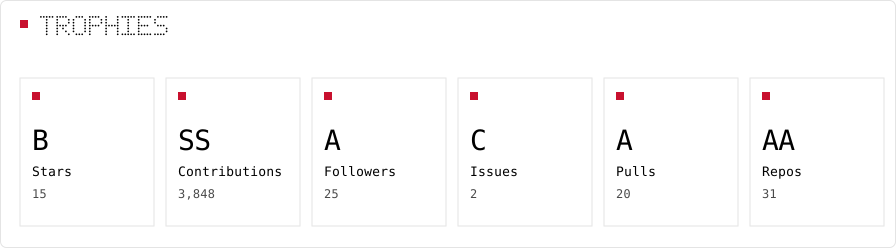

## light

**trophies** · light · mini

`https://github.com/itsrealkaran/nothing-github-trophies?username=itsrealkaran&theme=light&size=mini`

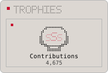

**trophies** · light · compact

`https://github.com/itsrealkaran/nothing-github-trophies?username=itsrealkaran&theme=light&size=compact`

**trophies** · light · regular

`https://github.com/itsrealkaran/nothing-github-trophies?username=itsrealkaran&theme=light&size=regular`

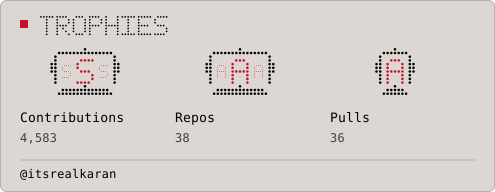

**trophies** · light · wide

`https://github.com/itsrealkaran/nothing-github-trophies?username=itsrealkaran&theme=light&size=wide`

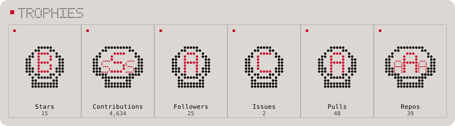

## red

**trophies** · red · mini

`https://github.com/itsrealkaran/nothing-github-trophies?username=itsrealkaran&theme=red&size=mini`

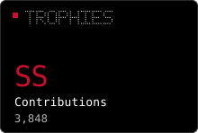

**trophies** · red · compact

`https://github.com/itsrealkaran/nothing-github-trophies?username=itsrealkaran&theme=red&size=compact`

**trophies** · red · regular

`https://github.com/itsrealkaran/nothing-github-trophies?username=itsrealkaran&theme=red&size=regular`

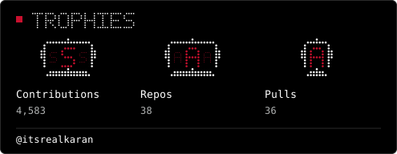

**trophies** · red · wide

`https://github.com/itsrealkaran/nothing-github-trophies?username=itsrealkaran&theme=red&size=wide`

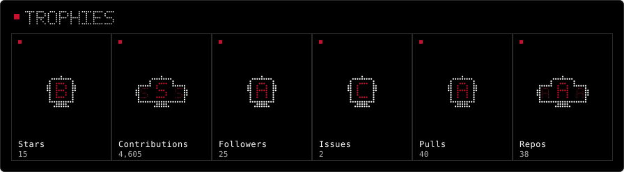

## blue

**trophies** · blue · mini

`https://github.com/itsrealkaran/nothing-github-trophies?username=itsrealkaran&theme=blue&size=mini`

**trophies** · blue · compact

`https://github.com/itsrealkaran/nothing-github-trophies?username=itsrealkaran&theme=blue&size=compact`

**trophies** · blue · regular

`https://github.com/itsrealkaran/nothing-github-trophies?username=itsrealkaran&theme=blue&size=regular`

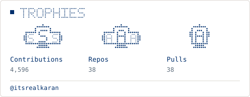

**trophies** · blue · wide

`https://github.com/itsrealkaran/nothing-github-trophies?username=itsrealkaran&theme=blue&size=wide`

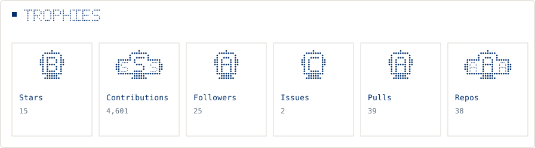

## yellow

**trophies** · yellow · mini

`https://github.com/itsrealkaran/nothing-github-trophies?username=itsrealkaran&theme=yellow&size=mini`

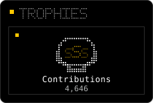

**trophies** · yellow · compact

`https://github.com/itsrealkaran/nothing-github-trophies?username=itsrealkaran&theme=yellow&size=compact`

**trophies** · yellow · regular

`https://github.com/itsrealkaran/nothing-github-trophies?username=itsrealkaran&theme=yellow&size=regular`

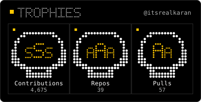

**trophies** · yellow · wide

`https://github.com/itsrealkaran/nothing-github-trophies?username=itsrealkaran&theme=yellow&size=wide`

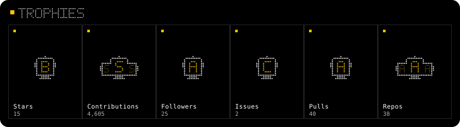

